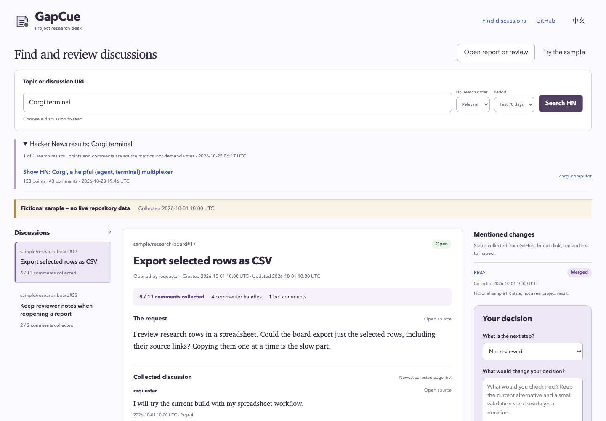

# GapCue · Project Research Desk

**Read the replies before you build.**

A feature request can outlive the work that answers it. Before turning an open issue into your next product, read the later discussion, inspect the linked changes, and keep the evidence beside your decision.

GapCue is a browser research desk with a small read-only GitHub CLI collector. **Search Hacker News. Read public GitHub issues. Keep the sources beside your decision.** No Python or API key is needed for browser collection.

[Try the review desk](https://lydiatools.github.io/gapcue/) · [中文说明](README.zh-CN.md) · [Download](https://github.com/LydiaTools/gapcue/releases) · [Report a problem](https://github.com/LydiaTools/gapcue/issues)



*Actual app: the search result is a public HN story; the review example below it is original fiction and visibly labeled. Neither is evidence of GapCue adoption or an upstream endorsement.*

## Start with a real discussion

1. Open the [research desk](https://lydiatools.github.io/gapcue/), type a topic such as `PDF tables`, and select **Search HN**. The default period is the past 90 days; choose recent/relevant results or another period.
2. Choose a story to read its original post, newest/oldest indexed comment samples and project link. Or paste a public GitHub Issue / Hacker News story URL directly.
3. Compare what people ask for with the current alternatives. Record **Follow up**, **Prototype candidate** or **Pass for my task**, then **Save review file**.
4. Close the tab and reopen that file to continue with the same source snapshot and notes. Saved reviews also work disconnected.

Search points and comment counts describe those posts at collection time. They are not a demand score, user count or forecast. A project's link is a starting point for checking its code and license.

## The question behind the issue

“Could you add CSV export?” is a useful starting point. But what happened afterward?

- Did a maintainer already point to an implementation?
- Is the linked PR open, closed, or merged?
- Did your collection skip the middle of the discussion?
- What would you need to check before building something?

GapCue puts those questions on one desk. You make the decision: **follow up, try a prototype, or pass for your task**. The source snapshot and your notes travel together in one review file.

## What works today

| Your task | GapCue provides |
| --- | --- |
| Find projects discussed elsewhere | Hacker News keyword search, relevant/recent order and an explicit time period |
| Read a real thread without installing anything | Paste one public GitHub Issue or HN story URL into the browser |
| Collect several GitHub issues | Python CLI: explicit issue URLs, or bounded search within one public repository |
| Check what happened later | First and last comment pages, shown with the newest collected comments first |
| Know what you missed | Collected/reported counts, visible omissions, shortened excerpts and unavailable sources |
| Inspect mentioned work | Current state checks for mentioned issues/PRs; branch and commit links stay clearly marked as links |
| Separate sources from judgment | Original excerpts and bot/association metadata beside your own decision notes |
| Return to the same evidence | Download and reopen a review containing the exact report text, its SHA-256 and your notes |
| Work in either language | English/Chinese controls; original source language is preserved |

The browser app uses plain HTML, CSS and JavaScript: no build step, model API, database or account setup. Public reads happen only after you search or choose a discussion. Search terms go to HN Search; public source requests go to GitHub, HN Search or the official HN API. Cookies and authentication are omitted. Reports and notes are not uploaded or saved automatically. The optional multi-issue collector uses Python's standard library.

## Try the offline review workflow

1. Open the [review desk](https://lydiatools.github.io/gapcue/).
2. Read the fictional sample. Notice that the issue is open while a mentioned PR is marked merged; neither is a release verdict.
3. Choose a next step, write a note, and select **Save review file**.
4. Reload the page, open that file, and continue with the same sources and notes.

For a local copy, download and extract the [preview ZIP](https://github.com/LydiaTools/gapcue/releases), then open `app/index.html` in Chrome. No server is needed for the viewer.

## Optional Python collector for several GitHub issues

Requires **Python 3.10+** and internet access. No Python packages to install.

```bash
git clone https://github.com/LydiaTools/gapcue.git
cd gapcue
python3 gapcue.py collect --issue obsidianmd/pele#35 --references 0 --out artifacts/first-look
```

Open `artifacts/first-look/report.json` in the review desk. This example reads a real public thread; its state and contents can change. Output directories must be new, so choose a new name for each collection.

To inspect references and another issue, repeat `--issue` and allow a bounded reference budget:

```bash
python3 gapcue.py collect \
  --issue OWNER/REPO#123 --issue OWNER/REPO#456 \
  --page-size 10 --references 6 --out artifacts/another-look
```

Replace `OWNER/REPO#123` and `#456` with real issue targets. To search one repository instead:

```bash
python3 gapcue.py collect --repo obsidianmd/pele --query layout --limit 2 --references 0 --out artifacts/layout-search
```

Anonymous GitHub requests are rate-limited. If GitHub CLI is already installed and logged in, add `--backend gh` to reuse it. The application does not ask you to paste a token into the viewer. Repository visibility is checked before thread content; private repositories are refused even with this backend.

Each run writes `report.json`, a short `report.md`, and `SHA256SUMS.txt`. Exit codes: `0` requested reads completed; `1` a partial report with source failures; `2` invalid arguments or output failure. There are no automatic retries or old-snapshot substitutions.

## Deliberate limits

- **A research aid, not a demand forecast.** Stars, reactions, handles and open issues do not establish independent users, willingness to pay, or a viable product. GapCue produces no opportunity score.
- **A sample, not the entire conversation.** Browser collection reads one thread. GitHub: up to 10 first and 10 last comments, with at most two mentioned issue/PR checks. HN: up to 10 newest and 10 oldest available indexed comments; indexing can lag the official count, and sampled replies can have unsampled parents. Parent/source links remain available. Python supports up to six GitHub issues and six mentioned-reference checks. Reads are bounded and non-atomic; substantial middle discussion may be absent.
- **Public reads can fail.** Browser responses are limited to 1 MiB each, with a 20-second timeout and no automatic retries. GitHub anonymous limits and network/CORS failures remain visible. Stop, failure or a late older response does not replace your current review. A failed comment/reference read can produce an explicitly partial snapshot.
- **Mention checks, not a full dependency graph.** Explicit GitHub issue/PR URLs and simple same-repo `#123` mentions are recognized. It does not enumerate the timeline, infer every linked PR, inspect code, validate a fix, or check releases. Commit/branch links are not fetched.
- **Snapshots age.** A checked PR state is what GitHub returned during collection. “Merged” is not “released,” and “closed” is not “solved for your task.” Edited comments can sit outside the collected pages.
- **Local notes require a download.** Closing an unsaved tab can lose your review. The SHA-256 detects a changed source inside the bundle; it is not a signature proving authorship or authenticity. A review contains the collected text and your notes: inspect it before sharing.
- **Early preview.** Desktop Chrome and a mobile-sized Chrome viewport were exercised. Independent user adoption, Safari/Firefox compatibility and product-market fit have not been established. See [validation](docs/VALIDATION.md).

## How this fits

GitHub itself and `gh` are excellent ways to inspect a thread. GapCue adds a small, portable review surface for a deliberately limited collection.

Other research tools already explore this space: [gh-research](https://github.com/muneebhashone/gh-research) describes agent-oriented JSON research and ranking; [ghscout](https://github.com/lucianfialho/ghscout) describes issue clustering and scoring; [GitHub Opportunity Miner](https://github.com/whitesungun876/Opportunity-Mining-Agent) describes AI opportunity cards. These are related options, not integrations or endorsements. GapCue focuses on human reading, visible sample gaps and a saved decision. Their implementation and effectiveness were not benchmarked here.

## Develop

The app runs directly from `app/index.html`. Optional local HTTP preview:

```bash
node scripts/serve.cjs
# http://127.0.0.1:8858
```

Tests use Node 20+ and Python 3.10+. Playwright is a development dependency only:

```bash
npm ci
python3 -m unittest discover -s tests -v
npm test
npx playwright install chromium
BROWSER_CHANNEL=chromium npm run test:browser
BROWSER_CHANNEL=chromium npm run test:research
```

If Chrome is installed, the browser scripts use it by default. The research harness normally intercepts APIs with original synthetic fixtures; set `GAPCUE_REAL_PUBLIC=1 npm run test:research` for a bounded live anonymous API check (network and rate limits apply). The browser test's generated reports stay in ignored `artifacts/`. Rebuild the original fictional sample with `python3 scripts/build-sample.py`.

[Report/review format](docs/FORMAT.md) · [Validation and scope](docs/VALIDATION.md) · [Contributing](CONTRIBUTING.md) · [Provenance](THIRD_PARTY_NOTICES.md)

## Independent project

GapCue is independently authored by [LydiaTools](https://github.com/LydiaTools). It is not an internal or leaked prompt, a vendor product, an official GitHub integration, or a renamed copy of an upstream repository. Public issue content remains attributable to its original authors; no real third-party discussion is bundled as demo content. The source code and original fictional examples are **MIT licensed**. Related projects and GitHub are not affiliated with or endorsing this project.

If this helps your research, a Star makes the project easier to find. More useful still: [tell me where the sources or workflow let you down](https://github.com/LydiaTools/gapcue/issues).
