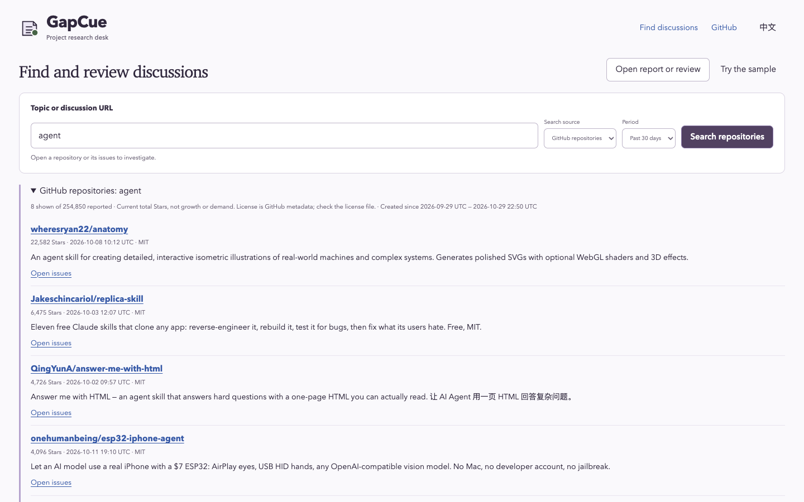

# GapCue · Project Research Desk

**A good idea deserves a closer look before you build it.**

An open issue catches your eye. Someone is asking for exactly the tool you had in mind.

You scroll a little further. Another person has found a workaround. A maintainer has linked a pull request. The issue is still open, but your question has changed: **what is still left to solve?**

GapCue gives you a place to follow that question. Search GitHub projects and Hacker News, read public discussions, and keep the sources beside your own decision. Start in your browser, or bring the included research skill to your coding agent.

**[Open GapCue](https://lydiatools.github.io/gapcue/)** · [中文说明](README.zh-CN.md) · [Download](https://github.com/LydiaTools/gapcue/releases) · [Report a problem](https://github.com/LydiaTools/gapcue/issues)

The browser desk needs no account, Python, or API key. Search a topic, or open the included fictional example to try the review workflow.



*An actual anonymous repository search, captured 2026-10-29 UTC. Results and Star counts change over time.*

## One question led us further

In [a real worktree handoff discussion](docs/case-worktree-handoff.md), a coding agent could report that its work was merged while uncommitted files were still in another worktree. We followed the public issue, reproduced the underlying Git situation locally, and compared existing options. Our conclusion: a useful check to keep investigating, not proof that a new product was needed.

That's the kind of trail GapCue helps you keep: **the original discussion, what you checked, and the decision you made with the evidence available.**

Another trail started with a popular request for [mobile and desktop UI evidence](docs/case-mobile-ui-research.md). Looking at what exists today led us to keep researching instead of starting another general simulator tool.

## From an idea to a decision

You don't need a finished idea to begin. Start with a question, follow the conversation, and leave yourself a record of what you found and why it mattered.

1. **Find a lead.** In the [research desk](https://lydiatools.github.io/gapcue/), search a topic such as `PDF tables` on **Hacker News** or **GitHub repositories**. Choose a time period; HN also offers recent/relevant order.
2. **Read what happened next.** Choose an HN story, or paste a public GitHub Issue or HN story URL. For a repository result, open its source or issues first, then bring a specific Issue URL back to the desk.
3. **Make your call.** Compare the discussion with existing options. Choose **Follow up**, **Prototype candidate** or **Pass for my task**, add a note, and select **Save review file**.
4. **Come back to the evidence.** Reopen the file later to see the same source snapshot and your notes. Saved reviews work offline too.

Looking for an idea? Select **Explore rising agent projects** in the browser desk to read [AgentAtlas's curated snapshot](https://agentatlas.dev/trending) of recently created agent repositories. It shows the feed's generation time and its average Stars per day since creation; this is not a live growth rate or proof of demand. The list is not a keyword search, and it is not included in saved reviews. Feed descriptions may be shortened. Data attribution: AgentAtlas, [CC BY 4.0](https://creativecommons.org/licenses/by/4.0/). This feature is in current source and the online desk; the fixed v0.4.0 ZIP predates it.

<details>
<summary>How repository search and its numbers work</summary>

GitHub repository search shows up to eight matches, sorted by **current total Stars**, not Star growth. For a selected period, GitHub filters by creation date from the UTC calendar date calculated when the search runs; archived repositories and forks are excluded. An incomplete GitHub response is labeled. A license label is GitHub metadata, not a rights assessment: inspect the actual license and assets. Search points and comment counts describe those posts at collection time. They are not a demand score, user count or forecast. A project's link is a starting point for checking its code and license.

</details>

## Use it from your coding agent

Install the bundled research skill into your current project (the verified installer version is pinned):

```bash
npx skills@1.7.4 add LydiaTools/gapcue --skill gapcue --agent codex
```

Then ask: **“Use GapCue to research PDF table workflows. Read later replies, compare current alternatives, and save the evidence with a follow-up or prototype decision.”**

The skill includes the collector and offline viewer. Its Node CLI reuses the browser's source adapters and review format; it needs Node 20+, with no runtime npm dependencies or model API. See [validation](docs/VALIDATION.md) for the installation and execution checks.

To run it directly from this checkout or an extracted release:

```bash
node scripts/research.cjs repos "agent skills" --days 30 --out ./repos-01
node scripts/research.cjs search "PDF tables" --sort recent --days 90 --out ./search-01
node scripts/research.cjs collect "https://news.ycombinator.com/item?id=50214373" --out ./thread-01
node scripts/research.cjs review ./thread-01/review.json --verdict followup --note "Compare the current alternatives." --out ./decision-01
```

The HN URL is a real discussion example, not market validation. Replace it with your selected result. Each output directory must be new. Repository search writes `repos.json` with current Stars, creation dates, GitHub-reported totals and an incomplete-results flag; it is a separate search result, not a review file. Search writes `search.json`; collection writes the source report, a short Markdown index and an openable `review.json`; review adds notes without changing the original source bytes. Open that review in `app/index.html` or the online desk.

CLI exit codes: `0` completed reads/local save; `1` partial or unavailable sources; `2` arguments/files; `130` interrupted. Partial reads remain visible. The CLI never posts, scores an opportunity, retries automatically, or replaces an existing output directory. JavaScript collection is anonymous; the Python collector below can reuse an existing `gh` login for public reads. If your network uses a proxy, configure your Node process using the option supported by your Node version, rather than changing system routing.

## What works today

| Your task | GapCue provides |
| --- | --- |
| Find candidate repositories | GitHub repository search, creation period and current total Stars |
| Find projects discussed elsewhere | Hacker News keyword search, relevant/recent order and an explicit time period |
| Read a real thread without installing anything | Paste one public GitHub Issue or HN story URL into the browser |
| Collect several GitHub issues | Python CLI: explicit issue URLs, or bounded search within one public repository |
| Check what happened later | First and last comment pages, shown with the newest collected comments first |
| Read a reply in context | Show its collected parent, or read one public HN parent on demand |
| Know what you missed | Collected/reported counts, visible omissions, shortened excerpts and unavailable sources |
| Inspect mentioned work | Current state checks for mentioned issues/PRs; branch and commit links stay clearly marked as links |
| Separate sources from judgment | Original excerpts and bot/association metadata beside your own decision notes |
| Return to the same evidence | Download and reopen a review containing the exact report text, its SHA-256 and your notes |
| Work in either language | English/Chinese controls; original source language is preserved |

The browser app uses plain HTML, CSS and JavaScript: no build step, model API, database or account setup. Public reads happen only after you search, choose a discussion, request an HN parent comment, or request the AgentAtlas snapshot. Search terms go to the selected GitHub or HN Search service; the snapshot request goes to AgentAtlas without search terms. Discussion requests go to GitHub, HN Search or the official HN API. Cookies and authentication are omitted. Reports and notes are not uploaded or saved automatically. Parent comments fetched on demand are shown live and are not added to the saved review; an already-collected parent comes from the original snapshot. The optional multi-issue collector uses Python's standard library.

## Try the offline review workflow

1. Open the [review desk](https://lydiatools.github.io/gapcue/).
2. Read the fictional sample. Notice that the issue is open while a mentioned PR is marked merged; neither is a release verdict.
3. Choose a next step, write a note, and select **Save review file**.
4. Reload the page, open that file, and continue with the same sources and notes.

For a local copy, download and extract the [preview ZIP](https://github.com/LydiaTools/gapcue/releases), then open `app/index.html` in Chrome. No server is needed for the viewer.

## Optional Python collector for several GitHub issues

Requires **Python 3.10+** and internet access. No Python packages to install.

```bash
git clone https://github.com/LydiaTools/gapcue.git
cd gapcue
python3 gapcue.py collect --issue obsidianmd/pele#35 --references 0 --out artifacts/first-look
```

Open `artifacts/first-look/report.json` in the review desk. This example reads a real public thread; its state and contents can change. Output directories must be new, so choose a new name for each collection.

To inspect references and another issue, repeat `--issue` and allow a bounded reference budget:

```bash
python3 gapcue.py collect \
  --issue OWNER/REPO#123 --issue OWNER/REPO#456 \
  --page-size 10 --references 6 --out artifacts/another-look
```

Replace `OWNER/REPO#123` and `#456` with real issue targets. To search one repository instead:

```bash
python3 gapcue.py collect --repo obsidianmd/pele --query layout --limit 2 --references 0 --out artifacts/layout-search
```

Anonymous GitHub requests are rate-limited. If GitHub CLI is already installed and logged in, add `--backend gh` to reuse it. The application does not ask you to paste a token into the viewer. Repository visibility is checked before thread content; private repositories are refused even with this backend.

Each run writes `report.json`, a short `report.md`, and `SHA256SUMS.txt`. Exit codes: `0` requested reads completed; `1` a partial report with source failures; `2` invalid arguments or output failure. There are no automatic retries or old-snapshot substitutions.

## Deliberate limits

- **A research aid, not a demand forecast.** Stars, reactions, handles and open issues do not establish independent users, willingness to pay, or a viable product. GapCue produces no opportunity score.
- **A sample, not the entire conversation.** Browser collection reads one thread. GitHub: up to 10 first and 10 last comments, with at most two mentioned issue/PR checks. HN: up to 10 newest and 10 oldest available indexed comments; indexing can lag the official count, and sampled replies can have unsampled parents. Parent/source links remain available. Python supports up to six GitHub issues and six mentioned-reference checks. Reads are bounded and non-atomic; substantial middle discussion may be absent.
- **Public reads can fail.** Browser responses are limited to 1 MiB each, with a 20-second timeout and no automatic retries. GitHub anonymous limits and network/CORS failures remain visible. Stop, failure or a late older response does not replace your current review. A failed comment/reference read can produce an explicitly partial snapshot.
- **Mention checks, not a full dependency graph.** Explicit GitHub issue/PR URLs and simple same-repo `#123` mentions are recognized. It does not enumerate the timeline, infer every linked PR, inspect code, validate a fix, or check releases. Commit/branch links are not fetched.
- **Snapshots age.** A checked PR state is what GitHub returned during collection. “Merged” is not “released,” and “closed” is not “solved for your task.” Edited comments can sit outside the collected pages.
- **Local notes require a download.** Closing an unsaved tab can lose your review. The SHA-256 detects a changed source inside the bundle; it is not a signature proving authorship or authenticity. A review contains the collected text and your notes: inspect it before sharing.
- **Early preview.** Desktop Chrome and a mobile-sized Chrome viewport were exercised. Independent user adoption, Safari/Firefox compatibility and product-market fit have not been established. See [validation](docs/VALIDATION.md).

## How this fits

GitHub itself and `gh` are excellent ways to inspect a thread. GapCue adds a small, portable review surface for a deliberately limited collection.

Other research tools already explore this space: [gh-research](https://github.com/muneebhashone/gh-research) describes agent-oriented JSON research and ranking; [ghscout](https://github.com/lucianfialho/ghscout) describes issue clustering and scoring; [GitHub Opportunity Miner](https://github.com/whitesungun876/Opportunity-Mining-Agent) describes AI opportunity cards. These are related options, not integrations or endorsements. GapCue focuses on human reading, visible sample gaps and a saved decision. Their implementation and effectiveness were not benchmarked here.

## Develop

The app runs directly from `app/index.html`. Optional local HTTP preview:

```bash
node scripts/serve.cjs
# http://127.0.0.1:8858
```

Tests use Node 20+ and Python 3.10+. Playwright is a development dependency only:

```bash
npm ci
python3 -m unittest discover -s tests -v
npm test
npx playwright install chromium
BROWSER_CHANNEL=chromium npm run test:browser
BROWSER_CHANNEL=chromium npm run test:research
BROWSER_CHANNEL=chromium npm run test:repos
```

If Chrome is installed, the browser scripts use it by default. The research harness normally intercepts APIs with original synthetic fixtures; set `GAPCUE_REAL_PUBLIC=1 npm run test:research` for a bounded live anonymous API check (network and rate limits apply). The browser test's generated reports stay in ignored `artifacts/`. Rebuild the original fictional sample with `python3 scripts/build-sample.py`.

[Report/review format](docs/FORMAT.md) · [Validation and scope](docs/VALIDATION.md) · [Contributing](CONTRIBUTING.md) · [Provenance](THIRD_PARTY_NOTICES.md)

## Independent project

GapCue is independently authored by [LydiaTools](https://github.com/LydiaTools). It is not an internal or leaked prompt, a vendor product, an official GitHub integration, or a renamed copy of an upstream repository. Public issue content remains attributable to its original authors; no real third-party discussion is bundled as demo content. The source code and original fictional examples are **MIT licensed**. Related projects and GitHub are not affiliated with or endorsing this project.

If this helps your research, a Star makes the project easier to find. More useful still: [tell me where the sources or workflow let you down](https://github.com/LydiaTools/gapcue/issues).
