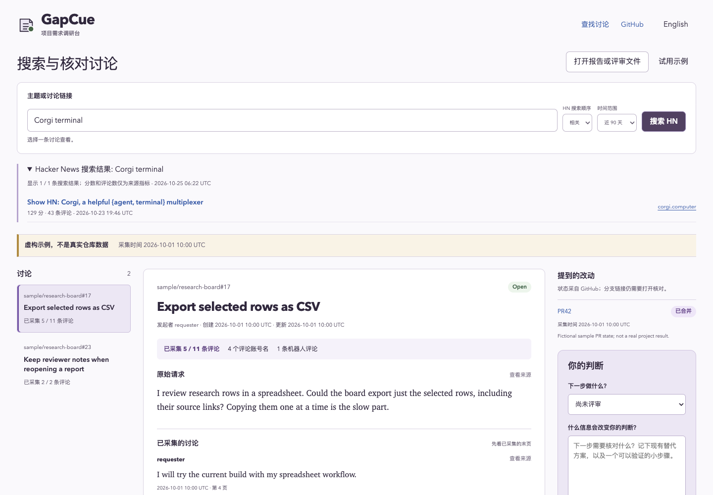
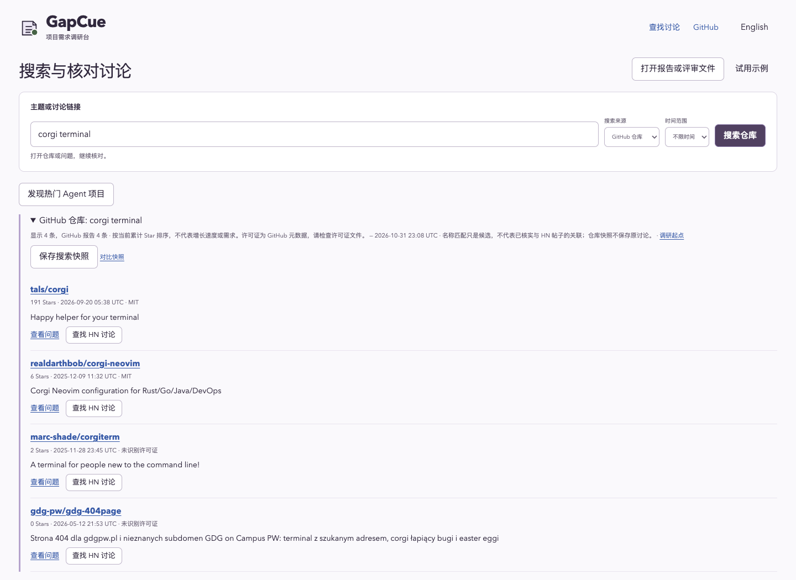
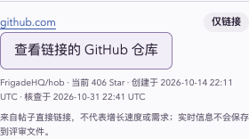
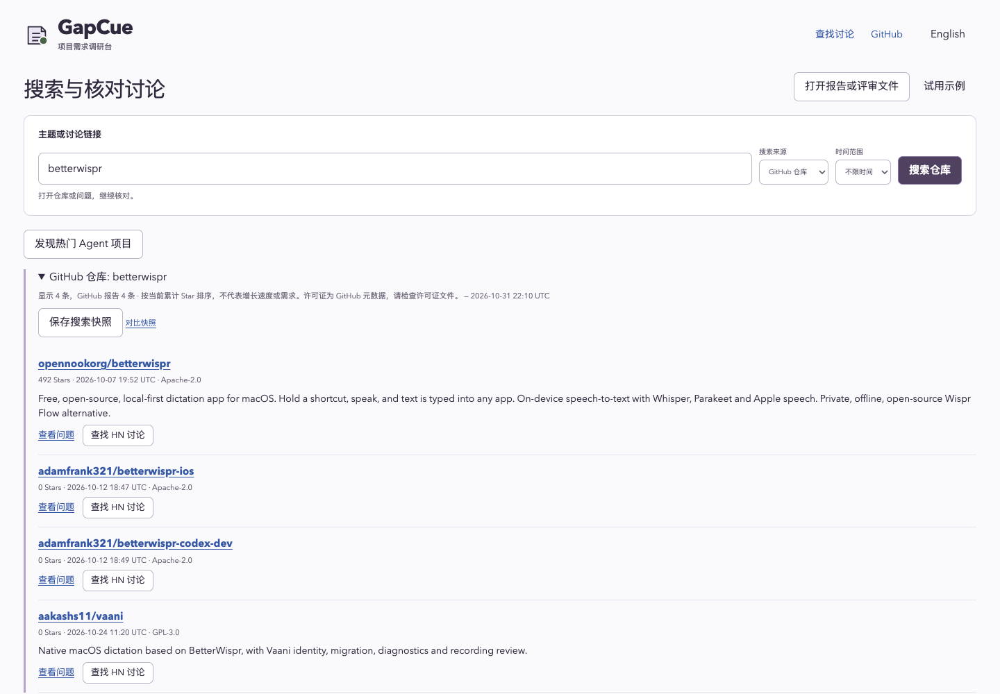
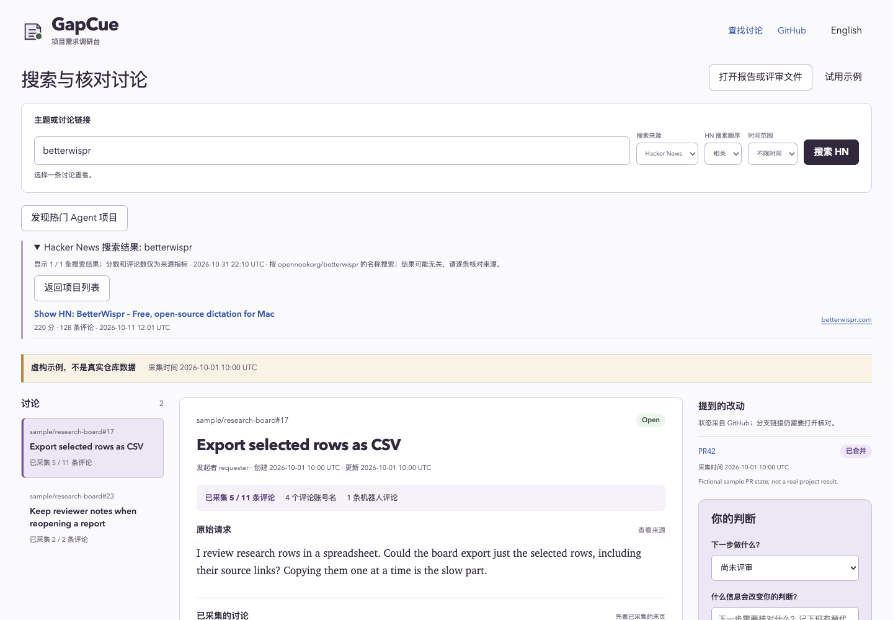
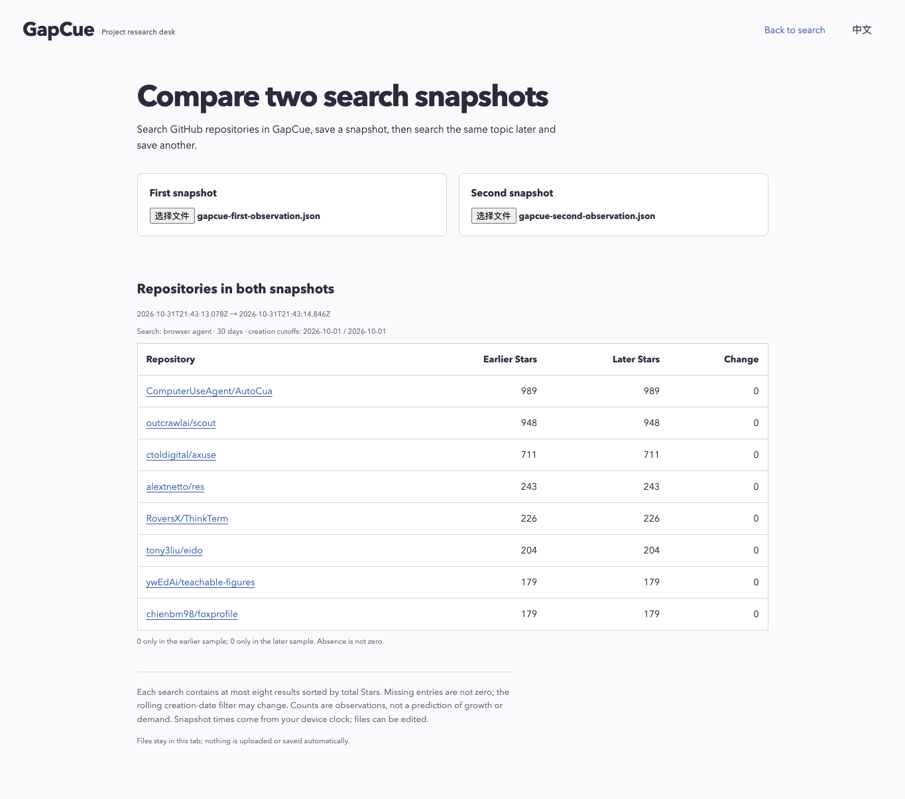

# GapCue · 项目需求调研台

**一个项目的 Stars 让你注意到它，Issue 里的讨论可能改变你的判断。**

你看到一个项目，Star 数让你停下来；再点进 Issue，有条功能请求和你想做的工具很像。你心里一动：“这个工具，我也想做。”那一刻，你甚至已经开始想象它会是什么样。

再往下翻，可能有人已经找到替代办法，维护者也贴出了 PR。Issue 还开着，却不代表用户的问题依旧没人解决。**提出问题的人，现在还缺什么？**

我做 GapCue，是想帮你留住从发现一个点子到决定要不要动手的那段过程。它是一款免费、开源的项目调研台：搜索 GitHub 仓库与 Hacker News，查看部分公开回复，并核对其中明确提到的 Issue 或 PR 状态。再把来源快照和下一步一起保存——继续跟进、试做原型，或先放一放。做不做由你决定；下次回来时，还能从这条线索接着看。

**[打开中文调研台](https://lydiatools.github.io/gapcue/?lang=zh)** · [English](README.md) · [下载 v0.7.0 预览版](https://github.com/LydiaTools/gapcue/releases/tag/v0.7.0) · [反馈](https://github.com/LydiaTools/gapcue/issues)

**现在就试：**在网页搜索一个话题，例如 `PDF tables`；也可以先打开明确标注的虚构示例。网页无需账号、Python 或 API Key。如果你习惯和编程 Agent 一起工作，也可以使用仓库里的[调研技能](#让编程-agent-直接做调研)。



*截图来自实际应用：搜索结果是真实公开 HN 帖子，下方评审为标注的原创虚构示例。界面语言切换不会翻译原始来源。*

## 从一个想法，走到下一步决定

从一个项目、一条需求，或一个你一直惦记的问题开始。把来源和当时的想法一起留下；下次回来时，你能看见自己查到了什么，也能想起为什么选择继续、试做，或先放一放。

1. **先找线索。** 搜索 GitHub 公开仓库、Hacker News 讨论或 Stack Overflow 问题，例如输入 `PDF tables`。从仓库查找 HN 讨论，也可以从 HN 讨论查找 GitHub 候选仓库。
2. **看看后来发生了什么。** 打开 HN 帖子或 Stack Overflow 问题，或粘贴公开的 GitHub Issue 链接。看看抽样评论和提到的变更；需要更多上下文时，回到原始来源。
3. **留下你的判断。** 对照讨论和现有方案，选择“继续核对”“候选小样”或“不适合当前任务”，并写下自己的想法。
4. **下次从这里继续。** 保存包含来源快照和笔记的评审文件；之后即使离线，也能重新打开。你还可以保存并[对比仓库搜索快照](#看一个项目随时间发生了什么变化)。

等你回来看这个点子，还能找到当时看到了什么、为什么这样决定。

Stack Overflow 调研页会读取问题和最多 10 条按票数排序的回答。每条结果都保留原文、作者和内容许可证链接。它是讨论样本，不是完整讨论，也不是需求度量。在线调研台与 v0.7.0 预览版均包含该页面。

<details>
<summary>看看如何在 Hacker News 和 GitHub 之间寻找线索</summary>

在[中文调研台](https://lydiatools.github.io/gapcue/?lang=zh)选择来源和时间范围；HN 还可按最新或相关排序。在仓库结果中点击“查找 HN 讨论”，会按项目名称搜索全部时间的帖子。打开帖子后，最初的仓库会作为**尚未核实的搜索起点**随评审文件保存。同名结果可能无关，讨论也可能使用不同名称；请打开原文核对。在线调研台与 v0.6.1 预览版包含此入口，v0.6.0 ZIP 早于此功能。

如果 HN 结果直接链接到 GitHub，点击“查看链接的 GitHub 仓库”可按需读取当前 Star 和创建时间；如为归档或派生仓库也会标注。实时信息不会保存进评审文件，不能当作增长或需求分数。v0.6.1 ZIP 早于此按钮。

如果帖子先指向官网，可点击“按名称查找仓库”，修改建议的名称后搜索 GitHub；候选列表保留回到 HN 结果或打开原讨论的入口。同名项目可能无关，目标仓库也可能不在前八条中；请对照项目自己的链接核实。仓库快照不保存原讨论。在线调研台与 v0.6.2 预览版包含该入口，v0.6.1 ZIP 早于此功能。



*2026-10-31 UTC 实际匿名搜索：将建议的 Corgi 修改为 corgi terminal；项目官网链接到 `tals/corgi`。数量和排序可能变化。*



*2026-10-31 UTC 从 Hob 的 HN 讨论实际匿名查询；Star 数会变化。*

<p></p>

*2026-10-31 UTC 的实际搜索：先找到 BetterWispr 仓库，再找到按名称匹配的 HN 讨论；该讨论提交的是项目官网。搜索区下方是已标注的虚构评审示例。结果会变化，也不代表项目方背书或 GapCue 已被外部用户采用。*

</details>

## 从一条真实线索开始

有时候，调研带来的收获不是一个马上要做的项目，而是更清楚：问题在哪里，接下来还要核对什么。

- **[哪个 Agent 在等你？](docs/case-agent-inbox-research.zh-CN.md)：** 一条社区讨论让我们找到五个已有的 Agent 看板或审核工具；在再做一个之前，先研究它们对 Codex 的实际支持。该案例已包含在 v0.7.0 预览版中。
- **[下载模型后，空间去哪了？](docs/case-model-storage-research.zh-CN.md)：** 从本地 AI 讨论出发，我们找到具体的 Ollama 报告、修复提案和已有工具；目前的决定是继续研究。此案例已包含在 v0.7.0 预览版中；v0.6.1 下载包早于此案例。
- **[看起来已经完成的交接](docs/case-worktree-handoff.zh-CN.md)：** 提交一致时，未提交的文件仍可能留在另一个工作区。本地 Git 测试还展示了：清理前状态看似干净，也可能漏掉被忽略的文件。新增的清理检查已包含在 v0.7.0 预览版中。
- **[一条关于界面验证的热门讨论](docs/case-mobile-ui-research.zh-CN.md)：** 从移动端和桌面测试的讨论出发，我们查看了现有方案，决定先继续研究，再考虑是否需要做通用模拟器工具。
- **[一条字幕，三个工具](docs/case-caption-research.zh-CN.md)：** 从竖屏视频讨论出发，我们用中文字幕样本试用了三个工具，并以英文样本作对照。这帮助我们缩小了下一步的问题，但一个样本还不能证明市场需求。

GapCue 想帮你留下的，就是这样的过程：**原始讨论、你核对过什么，以及基于现有证据做出的决定。** 下次回来，既能看到结论，也能找回当时为什么这样想。

## 看一个项目随时间发生了什么变化

想观察一段时间内的变化？选择“GitHub 仓库”搜索并点击“保存搜索快照”；稍后用相同主题和时间范围重新搜索，再保存第二份。打开[快照对比页](https://lydiatools.github.io/gapcue/compare.html?lang=zh)，本地选择两份文件。工具按 GitHub 仓库 ID 对齐，只计算两次都出现的项目。每次最多 8 条，未出现不代表零；滚动创建日期筛选也可能变化。数字和设备时钟记录的是观察值，不代表需求或未来增长。搜索快照与讨论评审文件分开保存。

离线对比时，解压 v0.7.0 预览 ZIP，在 Chrome 打开 `app/compare.html`；重新搜索需要连接 GitHub。旧版 CLI 的 `repos.json` 与浏览器快照格式不兼容。



*截图来自 2026-10-31 UTC 的真实匿名搜索，两次间隔约两秒，用于验证流程；数字不代表有意义的增长区间。对比页包含在 v0.6.0 中，旧 v0.5.0 ZIP 不包含它。*

想找选题？在网页点击“发现热门 Agent 项目”，查看 [AgentAtlas 的精选快照](https://agentatlas.dev/trending)：它展示榜单生成时间和项目自创建以来的日均 Star，不代表实时日增长或已验证的需求。这不是关键词搜索，榜单不会写入评审文件，简介可能被缩短。数据来自 AgentAtlas，遵循 [CC BY 4.0](https://creativecommons.org/licenses/by/4.0/)；在线调研台和 v0.5.0 预览版均包含此功能，旧 v0.4.0 源码包不包含。

<details>
<summary>仓库搜索和结果数字说明</summary>

GitHub 仓库搜索最多显示 8 条，按**当前累计 Star**排序，并非 Star 增长速度。时间范围从搜索时计算出的 UTC 日历日期开始，筛选仓库创建时间；排除归档仓库与 fork。GitHub 返回结果不完整时会提示。许可证标签是 GitHub 元数据，不代表已核实使用权；请检查许可证原文与素材。分数和评论数只是采集时的帖子指标，不是需求分、独立用户数或爆款预测。项目链接仍需要进一步核对源码、许可证和当前功能。

</details>

## 让编程 Agent 直接做调研

在当前项目安装随仓库提供的技能；下面固定为本次核验的安装器版本：

```bash
npx skills@1.7.4 add LydiaTools/gapcue --skill gapcue --agent codex
```

然后可以说：**“用 GapCue 调研 PDF 表格处理需求，看看后续评论和现有替代方案，把证据和是否继续做的判断一起保存。”**

技能自带采集器和离线查看页。Node CLI 复用网页的来源适配器与评审格式，需要 Node 20+，运行时无需 npm 依赖或模型 API。具体安装与运行验收见[验证记录](docs/VALIDATION.md)。

在源码或解压后的发行包中也可以直接运行：

```bash
node scripts/research.cjs repos "agent skills" --days 30 --out ./repos-01
node scripts/research.cjs search "PDF tables" --sort recent --days 90 --out ./search-01
node scripts/research.cjs collect "https://news.ycombinator.com/item?id=50214373" --out ./thread-01
node scripts/research.cjs review ./thread-01/review.json --verdict followup --note "核对当前替代方案，再决定是否做原型。" --out ./decision-01
```

示例链接是真实讨论，不代表市场机会已成立；实际使用时换成搜索选中的链接。每次输出目录必须是新的。仓库搜索生成独立的 `repos.json`，包含当前累计 Star、创建时间、GitHub 报告总数和结果是否完整，它不是评审文件。HN 搜索生成 `search.json`；采集生成来源报告、Markdown 索引及可打开的 `review.json`；评审保留原始来源字节，再加入判断与笔记。用 `app/index.html` 或在线调研台打开评审即可。

退出码：`0` 表示请求完成或本地保存完成，`1` 表示来源部分失败/不可用，`2` 表示参数或文件错误，`130` 表示中断。失败不会自动重试，不覆盖旧目录。JavaScript 路径仅匿名读取；下文 Python 模式可复用已有 `gh` 登录读取公开来源。需要代理时使用当前 Node 版本支持的进程级配置，不更改系统路由。

## 已有功能

| 你要做的事 | 工具提供什么 |
| --- | --- |
| 发现候选仓库 | GitHub 仓库搜索，按创建时间和当前累计 Star 查看 |
| 在其他平台发现项目 | Hacker News 主题搜索，可选相关/最新和时间范围 |
| 搜索开发者问题 | Stack Overflow 问题搜索，显示作者、原文和许可证链接 |
| 不安装工具就读真实讨论 | 在网页粘贴一个公开 GitHub Issue 或 HN 帖子地址 |
| 阅读开发者回答 | 查看 Stack Overflow 问题及最多 10 条按票数排序的回答，并可回到每条原文 |
| 批量采集 GitHub 问题 | 可选 Python 采集器：指定地址或限定一个仓库搜索 |
| 查看后续讨论 | 采集首尾评论页，优先展示已采到的最新评论 |
| 看懂回复的上文 | 展示已采集的上文，或按需读取一条公开 HN 上文评论 |
| 了解采集范围 | 已采/已报告数量、遗漏提示、原文截断和来源失败提示 |
| 核对提到的改动 | 读取提及的 Issue/PR 状态；分支、提交链接保持“仅链接” |
| 保留自己的判断 | 原文、机器人和作者关系标记，与判断笔记并列 |
| 下次接着看 | 评审文件保留原始报告文本、SHA-256 和笔记，可重新打开 |
| 分享给海外用户 | 中英文界面和文档，来源语言保持原样 |

网页使用原生 HTML/CSS/JavaScript，无需构建、数据库、模型 API 或账号。点击搜索、读取讨论、查询链接的 GitHub 仓库、查看 HN 上文或请求 AgentAtlas 快照后才请求公开来源：搜索词会发给 GitHub、Hacker News Search 或 Stack Exchange API；选择 Stack Overflow 问题后，工具再读取问题和回答；快照请求发给 AgentAtlas，不包含搜索词。页面为 Stack Overflow 每条内容提供来源、作者和许可证链接，将 HTML 转为纯文本，并标记缩短的片段。请求不携带 Cookie 或认证信息。为避免短时间重复搜索，Stack Overflow 页面会在浏览器本地存储已哈希的请求指纹和来源要求的暂停时间。报告与笔记不上传、不自动持久保存。Stack Overflow 的下载评审文件使用独立格式，只能在对应页面打开；旧版 CLI 报告不兼容。按需读取的 HN 上文为实时展示，不会加入保存的评审文件；如果上文已在采集样本中，则展示原始快照。可选批量采集器仅依赖 Python 标准库。

## 试用离线评审流程

1. 打开[中文调研台](https://lydiatools.github.io/gapcue/?lang=zh)。
2. 阅读明确标注为虚构的示例：Issue 仍是 Open，提到的 PR 标为已合并；这两个状态并不能证明已发布修复。
3. 选择下一步、写一条笔记，点击“保存评审文件”。
4. 刷新页面，再打开保存的 JSON，检查来源和笔记是否还在。

也可下载并解压 [v0.7.0 预览 ZIP](https://github.com/LydiaTools/gapcue/releases/tag/v0.7.0)，在 Chrome 打开 `app/index.html`。查看器不需要服务器。

## 可选：用 Python 批量采集 GitHub

需要 **Python 3.10+** 和网络，不需要安装 Python 包。

```bash
git clone https://github.com/LydiaTools/gapcue.git
cd gapcue
python3 gapcue.py collect --issue obsidianmd/pele#35 --references 0 --out artifacts/first-look
```

在调研台打开生成的 `artifacts/first-look/report.json`。命令读取真实公开讨论，其状态可能变化。每次使用新的输出目录，工具不会覆盖旧目录。

指定多个问题并核对提及的改动：

```bash
python3 gapcue.py collect \
  --issue OWNER/REPO#123 --issue OWNER/REPO#456 \
  --page-size 10 --references 6 --out artifacts/another-look
```

把示例编号替换成真实问题。限定一个仓库搜索：

```bash
python3 gapcue.py collect --repo obsidianmd/pele --query layout --limit 2 --references 0 --out artifacts/layout-search
```

匿名 GitHub API 有额度限制。已安装并登录 GitHub CLI 时，可加 `--backend gh` 复用登录态，不需要在网页粘贴 Token。工具在读取讨论前核对公开状态，即使用登录态也拒绝采集私有仓库。

每次生成 `report.json`、简短的 `report.md` 与 `SHA256SUMS.txt`。退出码 `0` 表示计划读取完成，`1` 表示报告有来源失败，`2` 表示参数或输出失败；不自动重试，不拿旧结果填补新失败。

## 边界与当前阶段

- **帮助调研，不预测需求。** Star、反应数量、账号名和 Open 状态不能证明独立用户数、付费意愿或产品机会；工具不会自动打“机会分”。
- **采集样本，不是完整讨论。** 网页每次读取一个讨论。GitHub 最多首尾各 10 条评论，核对最多 2 个提及的 Issue/PR；HN 最多读取索引中的最新/最早各 10 条评论，索引可能滞后，回复的父评论可能不在样本中，可打开父评论来源核对。Python 支持最多 6 个问题与 6 个引用核对。大讨论仍可能遗漏大量中间内容，采集并非同一瞬间完成。
- **公开读取也可能失败。** 网页单次响应上限 1 MiB、超时 20 秒，不自动重试。API 额度、网络或 CORS 失败会显示；停止、失败或过期的旧请求不会覆盖当前评审。评论页或引用读取失败时，已读取的来源会保留为明确的部分报告。
- **核对提及，不构建完整关系图。** 识别明确的 GitHub Issue/PR 地址和简单的同仓库 `#123`；不遍历时间线、不分析代码、不验证修复、不核对发行版，也不读取分支/提交内容。
- **状态会过期。** 合并不等于发布，关闭不等于解决了你的问题；旧评论的新编辑也可能落在采集范围外。
- **笔记需要自己保存。** 下载前关闭页面可能丢失修改。SHA-256 可核对包内原始文本是否变化，不能证明来源真实性或作者身份。评审文件带有原文和自己的笔记，分享前先检查。
- **目前是早期预览。** 已做桌面 Chrome 和手机尺寸的 Chrome 检查；不代表已验证真实用户采用、Safari/Firefox 或市场效果。详见[验收范围](docs/VALIDATION.md)。

## 与现有工具的关系

GitHub 页面和 `gh` 本来就能查看讨论。GapCue 增加的是小范围采集之后的人工阅读与评审文件。

相关工具已有 [gh-research](https://github.com/muneebhashone/gh-research)、[ghscout](https://github.com/lucianfialho/ghscout) 和 [GitHub Opportunity Miner](https://github.com/whitesungun876/Opportunity-Mining-Agent)，分别描述了 Agent JSON 调研、聚类评分、AI 机会卡片等路线。这里只说明它们存在，没有集成、背书，也没有对其效果做基准测试。

## 开发与来源

直接打开 `app/index.html`，或运行 `node scripts/serve.cjs` 后访问 `http://127.0.0.1:8858`。

Node 20+ 的开发测试命令、浏览器安装说明见[英文开发段落](README.md#develop)。[格式](docs/FORMAT.md) · [验收](docs/VALIDATION.md) · [贡献](CONTRIBUTING.md) · [来源说明](THIRD_PARTY_NOTICES.md)

这是 [LydiaTools](https://github.com/LydiaTools) 独立开发的个人开源项目，不是任何厂商的内部、泄露提示词或官方产品，也不是给别人的仓库换名。代码与原创虚构示例采用 **MIT** 许可；第三方公开讨论保留其原作者归属，不作为示例打包。GitHub 与相关项目未参与或背书。

如果你发现它漏掉了重要来源，或某处文字把证据说得太满，欢迎[带上具体例子告诉我](https://github.com/LydiaTools/gapcue/issues)。我会从这些真实卡点继续改。
