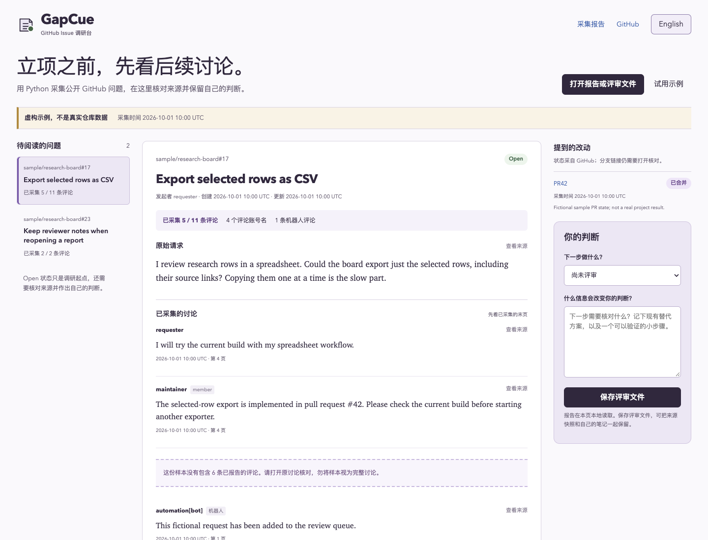

# GapCue · GitHub Issue 调研台

**立项之前，先看后续讨论。**

看到一条功能请求，很容易想“这个我来做”。但请求可能还开着，后面的评论已经给出了实现、替代方案，或者说明了另一个问题。

GapCue 帮你把公开 Issue、后续讨论、提到的改动和自己的判断放在一起。**最多 6 个问题，采集评论首尾页，保留来源，再决定下一步。**

[在线试用](https://lydiatools.github.io/gapcue/?lang=zh) · [English](README.md) · [下载预览版](https://github.com/LydiaTools/gapcue/releases) · [反馈](https://github.com/LydiaTools/gapcue/issues)



*截图来自实际应用。内置讨论是原创虚构示例，界面有明确标识，不代表真实用户需求或上游项目成果。切换界面语言不会翻译原始来源。*

## 先回答这几个问题

- 维护者后来有没有给出现成实现？
- 提到的 PR 还开着、关闭了，还是合并了？
- 我读到的是完整讨论，还是中间漏掉了一大段？
- 开始做之前，还需要验证什么？

你可以选择“继续核对”“候选小样”或“不适合当前任务”，写下原因，再保存一个包含原始报告和笔记的评审文件。以后打开它，继续处理同一份证据。

## 已有功能

| 你要做的事 | 工具提供什么 |
| --- | --- |
| 阅读少量相关问题 | 指定公开 Issue 地址，或限定一个仓库搜索 |
| 查看后续讨论 | 采集首尾评论页，优先展示已采到的最新评论 |
| 了解采集范围 | 已采/已报告数量、遗漏提示、原文截断和来源失败提示 |
| 核对提到的改动 | 读取提及的 Issue/PR 状态；分支、提交链接保持“仅链接” |
| 保留自己的判断 | 原文、机器人和作者关系标记，与判断笔记并列 |
| 下次接着看 | 评审文件保留原始报告文本、SHA-256 和笔记，可重新打开 |
| 分享给海外用户 | 中英文界面和文档，来源语言保持原样 |

采集器仅依赖 Python 标准库。查看器是原生 HTML/CSS/JavaScript，无需构建、数据库或模型 API；查看器不上传报告，也不会自动持久保存笔记。

## 一分钟试用

1. 打开[中文调研台](https://lydiatools.github.io/gapcue/?lang=zh)。
2. 阅读明确标注为虚构的示例：Issue 仍是 Open，提到的 PR 标为已合并；这两个状态并不能证明已发布修复。
3. 选择下一步、写一条笔记，点击“保存评审文件”。
4. 刷新页面，再打开保存的 JSON，检查来源和笔记是否还在。

也可下载并解压 [ZIP 预览版](https://github.com/LydiaTools/gapcue/releases)，在 Chrome 打开 `app/index.html`。查看器不需要服务器。

## 采集真实公开内容

需要 **Python 3.10+** 和网络，不需要安装 Python 包。

```bash
git clone https://github.com/LydiaTools/gapcue.git
cd gapcue
python3 gapcue.py collect --issue obsidianmd/pele#35 --references 0 --out artifacts/first-look
```

在调研台打开生成的 `artifacts/first-look/report.json`。命令读取真实公开讨论，其状态可能变化。每次使用新的输出目录，工具不会覆盖旧目录。

指定多个问题并核对提及的改动：

```bash
python3 gapcue.py collect \
  --issue OWNER/REPO#123 --issue OWNER/REPO#456 \
  --page-size 10 --references 6 --out artifacts/another-look
```

把示例编号替换成真实问题。限定一个仓库搜索：

```bash
python3 gapcue.py collect --repo obsidianmd/pele --query layout --limit 2 --references 0 --out artifacts/layout-search
```

匿名 GitHub API 有额度限制。已安装并登录 GitHub CLI 时，可加 `--backend gh` 复用登录态，不需要在网页粘贴 Token。工具在读取讨论前核对公开状态，即使用登录态也拒绝采集私有仓库。

每次生成 `report.json`、简短的 `report.md` 与 `SHA256SUMS.txt`。退出码 `0` 表示计划读取完成，`1` 表示报告有来源失败，`2` 表示参数或输出失败；不自动重试，不拿旧结果填补新失败。

## 边界与当前阶段

- **帮助调研，不预测需求。** Star、反应数量、账号名和 Open 状态不能证明独立用户数、付费意愿或产品机会；工具不会自动打“机会分”。
- **采集样本，不是完整讨论。** 最多 6 个问题，每个问题最多首尾 2 页、每页 1–20 条评论；整份报告最多核对 6 个唯一 Issue/PR 引用。大讨论可能遗漏大量中间评论。末页按读取 Issue 时的数量计算，采集并非同一瞬间完成。
- **核对提及，不构建完整关系图。** 识别明确的 GitHub Issue/PR 地址和简单的同仓库 `#123`；不遍历时间线、不分析代码、不验证修复、不核对发行版，也不读取分支/提交内容。
- **状态会过期。** 合并不等于发布，关闭不等于解决了你的问题；旧评论的新编辑也可能落在采集范围外。
- **笔记需要自己保存。** 下载前关闭页面可能丢失修改。SHA-256 可核对包内原始文本是否变化，不能证明来源真实性或作者身份。评审文件带有原文和自己的笔记，分享前先检查。
- **目前是早期预览。** 已做桌面 Chrome 和手机尺寸的 Chrome 检查；不代表已验证真实用户采用、Safari/Firefox 或市场效果。详见[验收范围](docs/VALIDATION.md)。

## 与现有工具的关系

GitHub 页面和 `gh` 本来就能查看讨论。GapCue 增加的是小范围采集之后的人工阅读与评审文件。

相关工具已有 [gh-research](https://github.com/muneebhashone/gh-research)、[ghscout](https://github.com/lucianfialho/ghscout) 和 [GitHub Opportunity Miner](https://github.com/whitesungun876/Opportunity-Mining-Agent)，分别描述了 Agent JSON 调研、聚类评分、AI 机会卡片等路线。这里只说明它们存在，没有集成、背书，也没有对其效果做基准测试。

## 开发与来源

直接打开 `app/index.html`，或运行 `node scripts/serve.cjs` 后访问 `http://127.0.0.1:8858`。

Node 20+ 的开发测试命令、浏览器安装说明见[英文开发段落](README.md#develop)。[格式](docs/FORMAT.md) · [验收](docs/VALIDATION.md) · [贡献](CONTRIBUTING.md) · [来源说明](THIRD_PARTY_NOTICES.md)

这是 [LydiaTools](https://github.com/LydiaTools) 独立开发的个人开源项目，不是任何厂商的内部、泄露提示词或官方产品，也不是给别人的仓库换名。代码与原创虚构示例采用 **MIT** 许可；第三方公开讨论保留其原作者归属，不作为示例打包。GitHub 与相关项目未参与或背书。

如果它让你少做一次重复验证，欢迎 Star。更有帮助的是[告诉我哪个步骤或来源提示还不够清楚](https://github.com/LydiaTools/gapcue/issues)。
